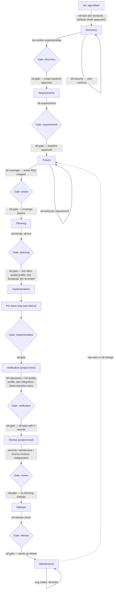
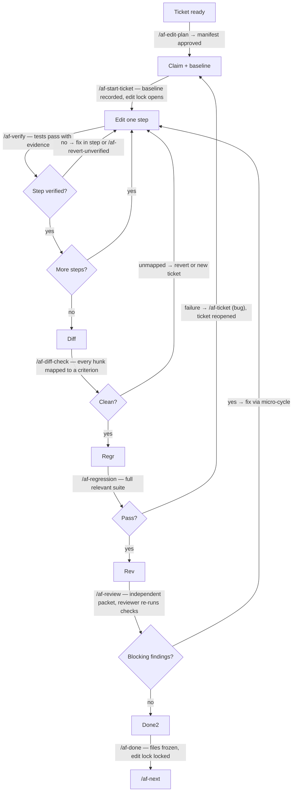
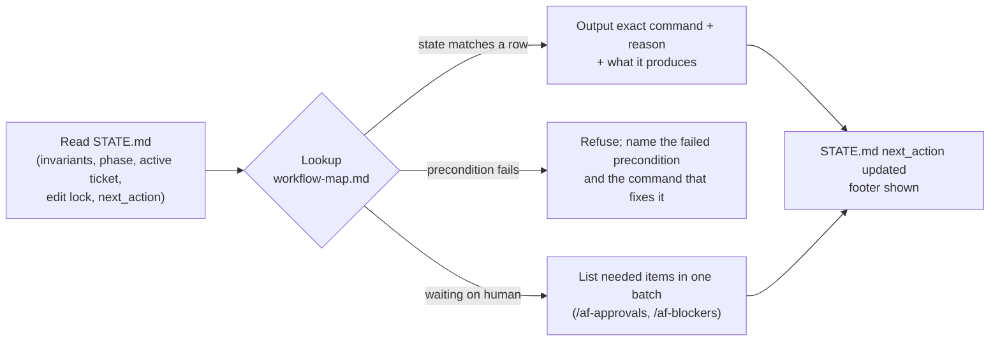

# Flow Diagrams

Command-labelled flow diagrams of Agentflow. The single source of truth for every edge is `.agentflow/workflow-map.md`; the owner approves each gate advance.

## Project phases with gates

After release, new work returns to `tickets` for those items only; baseline and decisions stay in force.

## Per-ticket implementation loop

Off-manifest needs at any point halt edits and route to `/af-expand-scope` (owner approval) before continuing.

## Command routing via /af-next

`/af-next` never performs or fakes a human approval — it only lists what needs you. In guided mode it announces the command, why, and what you must do; in expert mode the footer line is enough.
